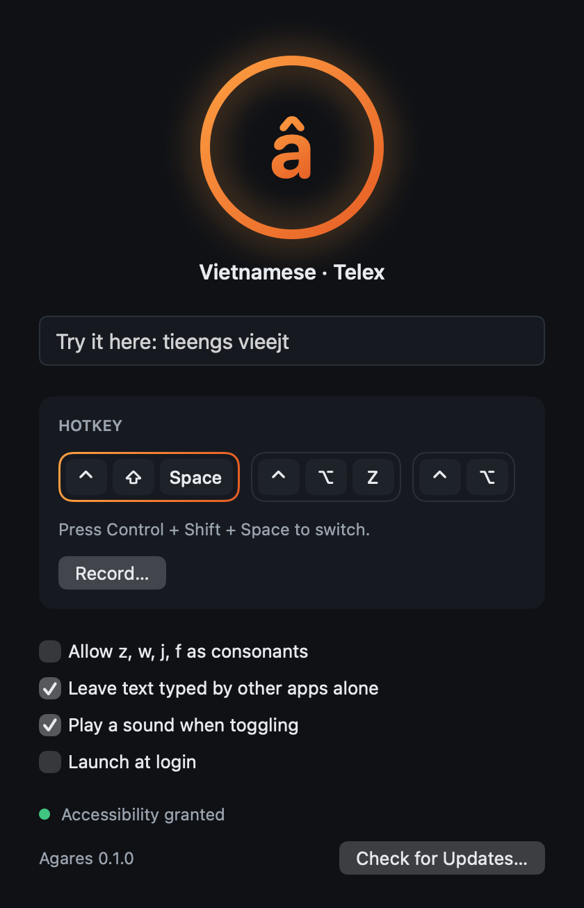
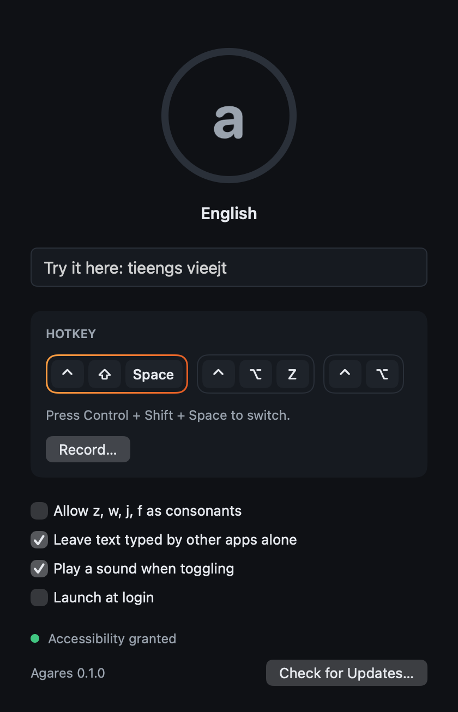
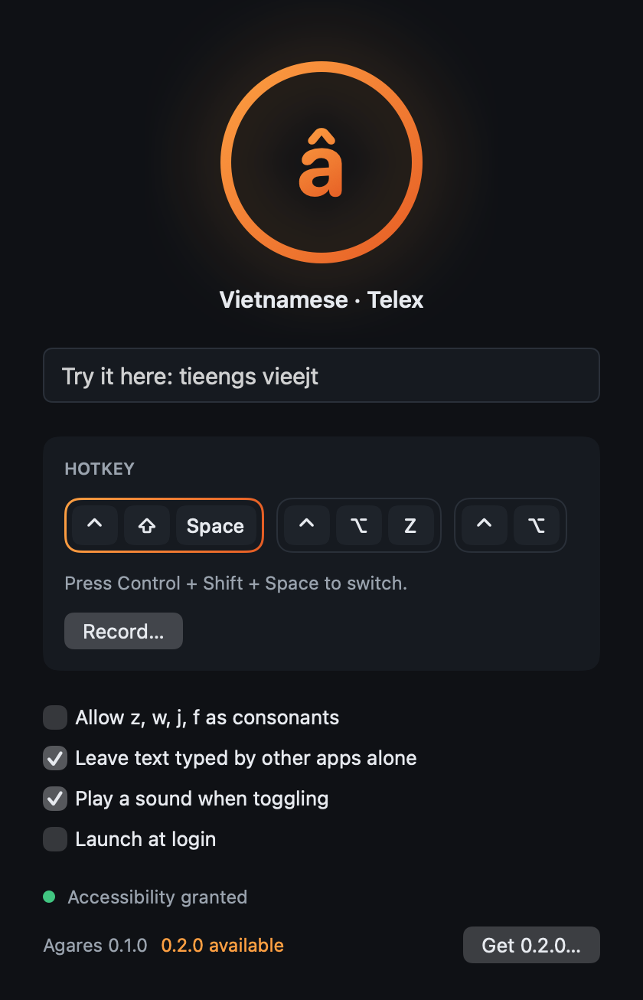

<h1 align="center">
  <br>
  Agares
</h1>

<p align="center">
  <a href="https://github.com/quyennguyenvu/agares/releases"></a>
  
  
</p>

Vietnamese Telex typing for macOS, in any app, with **no underlined composing text**. Every keystroke lands as real text the moment you press it, so search boxes and live filters react as you type — the way OpenKey and GoTiengViet work. Swift, no dependencies, local only: no account, no telemetry.

<p align="center">
  
  
</p>

## Why Agares

**Nothing to confirm.** The built-in macOS Telex holds your word in an underlined box until you press Space. Agares never does: type `tieengs` and `tiếng` is already in the field, so a search starts on the first letter.

**One hotkey, and it cannot fire by accident.** ⌃⇧Space (Control + Shift + Space) by default. It triggers only on that exact key press, never when a bigger chord such as ⌃⇧⌘4 happens to pass through it. Pick another preset or record your own in the panel, which also names the hotkey in words.

**You always know which mode you are in.** `V` or `E` in the menu bar, an optional tick or pop sound on every switch, and a seal in the panel that glows while Vietnamese is on.

**Small and local.** About 1,300 lines of Swift with no third-party code. The only network request Agares ever makes asks GitHub for the latest release number, at most once a day and when you choose Check for Updates. Nothing about you or your typing is sent.

In the Ars Goetia, Agares is the duke who "teaches all languages or tongues".

## Install

Grab the `.dmg` from the [Releases page](https://github.com/quyennguyenvu/agares/releases). One file runs on both Apple Silicon and Intel Macs, macOS 13 or newer.

Agares isn't signed with a paid Apple certificate (it's a personal project), so macOS blocks the **first** launch with a warning. The warning only means the developer didn't buy a certificate. Allow it once and it never appears again.

1. Open the `.dmg` and drag **Agares** onto **Applications**.
2. Open **Agares** from Applications. macOS says **"Apple could not verify 'Agares' is free of malware"**.
3. **Click "Done", not "Move to Trash".** Move to Trash is the highlighted button, and it deletes the app.
4. Allow it once, using either method below, then open Agares again.
5. Turn Agares on under **System Settings → Privacy & Security → Accessibility**. Agares opens its panel with a button that takes you there. It needs this permission because it reads your keystrokes to add the Vietnamese marks.

**Without Terminal.** Open **System Settings → Privacy & Security** and scroll to the **Security** section. Click **Open Anyway** and confirm with Touch ID or your password.

**With Terminal.**

```sh
xattr -dr com.apple.quarantine /Applications/Agares.app
```

> Right-click → **Open** used to work here. Apple removed it in macOS 15.

### Before you start typing

Use only one Vietnamese typing tool at a time. If OpenKey, GoTiengViet or the macOS **Vietnamese** input source is also active, your text gets converted twice. Quit the other tool, and keep the macOS input source on **ABC** or **U.S.**

### Updating

Agares tells you when a newer version exists. Once a day it asks GitHub for the latest release; if there is one, a dot appears beside `V` or `E` in the menu bar, the menu gains a **Version … Available…** item, and the panel shows a **Get …** button. Each opens the release page. Agares never downloads or installs anything itself.

<p align="center">
  
</p>

Replace the app in Applications with the newer version. Every release is signed with the same certificate, so the Accessibility permission carries over. If the menu bar shows `⚠` after an update anyway, open the panel, press **Reset Permission**, and switch Agares on in the Settings page that opens.

### Checking the download is genuine (optional)

Every release ships a `SHA256SUMS.txt`, and the installer carries a GitHub [build-provenance attestation][provenance].

```sh
# the file matches the published checksum
shasum -a 256 -c SHA256SUMS.txt --ignore-missing

# ...and it really came out of this repo's release workflow
gh attestation verify Agares-<version>.dmg --repo quyennguyenvu/agares
```

[provenance]: https://docs.github.com/actions/security-guides/using-artifact-attestations-to-establish-provenance-for-builds

## Using it

- **Switch** between Vietnamese and English with the hotkey, the menu bar item, or the seal in the panel.
- **Open the panel** from the menu bar item, or by opening Agares again from Launchpad or Spotlight. It holds the hotkey, two typing options, the sound switch, Launch at login and Check for Updates, plus a field to try your typing in.
- **Agares lives in the menu bar.** Its Dock icon is there only while the panel is open.
- **Closing the panel does not quit Agares**, and neither do ⌘Q or the Dock's Quit. To quit, click the menu bar item and choose **Quit Agares**.

### Telex in one table

| Type | Get | | Type | Get |
| --- | --- | --- | --- | --- |
| `aa` | â | | `s` | sắc: á |
| `aw` | ă | | `f` | huyền: à |
| `ee` | ê | | `r` | hỏi: ả |
| `oo` | ô | | `x` | ngã: ã |
| `ow` | ơ | | `j` | nặng: ạ |
| `uw` or `w` | ư | | `z` | remove the tone |
| `dd` | đ | | repeat a key | undo: `aaa` gives `aa` |

Tone and mark keys can come anywhere after the letter they belong to: `laays`, `layas` and `lasya` all give `lấy`, and `tieengs`, `tieesng` and `tiengse` all give `tiếng`. Tones follow the traditional placement (`hòa`, `thủy`).

### Good to know

- **English words while Vietnamese is on** can pick up marks: `test` becomes `tét`. Switch to English with the hotkey first. Words that cannot be Vietnamese, such as `class` or `css`, are left alone.
- **Words that start with z, w, j or f**, such as `zô`, `jì` or `fải`, need **Allow z, w, j, f as consonants** ticked in the panel. It is off by default, because English words starting with those letters would then pick up marks too.
- **Auto-type and text expanders** are left alone. Keys typed by another app, such as a password manager's auto-type, pass through unconverted whichever mode you are in, and they cannot trigger the hotkey. An on-screen keyboard types the same way, so if you use one, untick **Leave text typed by other apps alone** in the panel.
- **Password fields** are never touched; macOS keeps keystrokes there away from every app.
- **Going back into a finished word** and typing a mark key starts a new word, so the mark does not reach the old letters.
- **A keyboard layout other than ABC or U.S.** is not supported.

### If something looks off

- **`⚠` in the menu bar:** Agares does not have the Accessibility permission. Open the panel and press **Grant Accessibility…**. If Agares is already switched on there, macOS is holding a permission from an older build: press **Reset Permission** instead, then switch it on again.
- **Nothing happens after an update:** see [Updating](#updating).
- **Letters doubled or garbled:** another Vietnamese typing tool is running at the same time.

## Developing

You need macOS 13 or newer, a Swift 6 toolchain (the Command Line Tools are enough, no Xcode), and `librsvg` for the icon (`brew install librsvg`).

```sh
bash scripts/test.sh             # run the tests
bash scripts/make-cert.sh        # once: create the local "Agares Dev" signing certificate
bash scripts/bundle.sh install   # build, sign, copy to /Applications and launch
python3 scripts/sync-plans.py    # list source printed in the plans that no longer matches the repo
```

Builds are signed with the self-signed "Agares Dev" certificate so the Accessibility permission survives every rebuild. Releases use that same certificate; a certificate you create yourself is a different signer, so your builds and the released ones do not share a permission.

### Releasing

```sh
scripts/release.sh 0.2.0            # test, bump Resources/Info.plist, commit, tag, push
scripts/release.sh 0.2.0 --dry-run  # show what it would do
```

Pushing the `v0.2.0` tag starts `.github/workflows/release.yml`, which re-runs the tests, builds a universal app, signs it with the "Agares Dev" certificate, packages `Agares-0.2.0.dmg`, attaches a provenance attestation and `SHA256SUMS.txt`, and publishes the GitHub release with `.github/release-body.md` on top of the generated notes. Tags are always `v` plus three numbers; the in-app update check ignores anything else.

The workflow reads the certificate from two repository secrets, set once under **Settings → Secrets and variables → Actions**:

| Secret | Value |
| --- | --- |
| `SIGNING_P12_BASE64` | The certificate and its private key, exported and base64-encoded (below) |
| `SIGNING_P12_PASSWORD` | The passphrase you chose for that export |

```sh
# macOS asks for a passphrase to protect the file, then for your login password
security export -k ~/Library/Keychains/login.keychain-db -t identities -f pkcs12 -o agares-dev.p12
base64 -i agares-dev.p12 | pbcopy   # paste as SIGNING_P12_BASE64
rm agares-dev.p12
```

That command exports every signing identity in the login keychain, so run it while "Agares Dev" is the only one. The workflow refuses to publish a build whose signer is not that exact certificate, because a different signer would cost every user their Accessibility permission. Whoever holds these secrets can sign an app that macOS treats as Agares, so keep them to this repository.

### Layout

| Path | What lives there |
| --- | --- |
| `Sources/AgaresEngine` | Pure logic with no imports: the Telex engine, the hotkey rules, version comparison |
| `Sources/Agares` | The app: key hook, text replacement, menu bar item, panel, update check |
| `Tests/AgaresEngineTests` | Unit tests for everything in the engine |
| `scripts` | Test, certificate, bundle and release scripts, and the check that keeps the plans in step with the code |
| `docs/superpowers` | Design specs and implementation plans |

If `swift build` fails with `Invalid manifest` and `Undefined symbols … swiftLanguageVersions`, the Command Line Tools contain leftover files from an older Swift. Remove them with `sudo find /Library/Developer/CommandLineTools/usr/lib/swift/pm -name '*.private.swiftinterface' -delete`.
